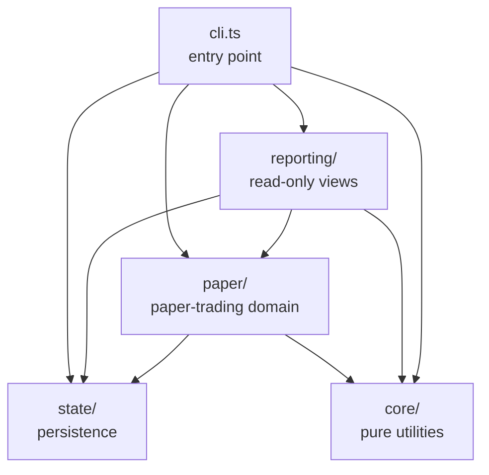
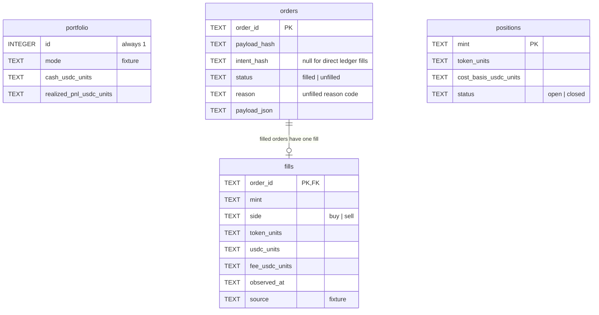
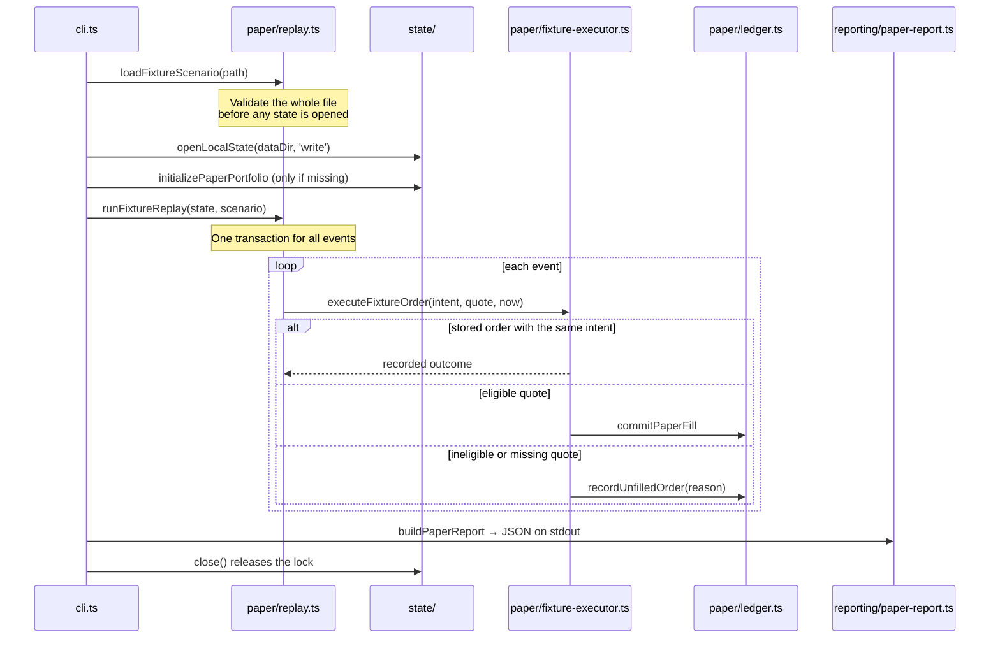

# Architecture

This document describes how the codebase is organized, the rules each layer follows, and the invariants the code must preserve. It reflects the code as it exists; planned parts are marked as planned.

**Keeping it current:** update this file in the same change that adds a module or layer, changes a contract in `src/paper/types.ts`, adds a schema migration, or changes an invariant below. Record notable decisions in the [decision log](#decision-log).

**Last updated:** 2026-10-14, Milestone 1 (local paper foundation), with lint, format, and CI tooling.

## Current scope

| Capability | Status |
|---|---|
| Exact integer monetary units | Implemented |
| Local SQLite state, single-writer lock, versioned migrations | Implemented |
| Persistent paper portfolio (cash, realized PnL) | Implemented |
| Atomic, idempotent paper ledger (orders, fills, positions) | Implemented |
| Fixture executor with quote-eligibility rules | Implemented |
| Validated, atomic scenario replay | Implemented |
| Read-only JSON and Markdown reports | Implemented |
| Risk limits, spending controls, crash recovery | Planned (Milestone 2) |
| Live discovery and market adapters | Planned (Milestone 3) |
| Model-assisted decisions through a budgeted LLM gateway | Planned (Milestone 4) |
| Isolated workshop and evaluation | Planned (Milestone 5) |

Everything runs locally in **fixture mode**: no network requests, no API keys, no wallet, no real funds.

## Layers

Source code lives in `src/`, split into layers. A layer may import only from layers below it. `pnpm lint` enforces these boundaries through `no-restricted-imports` rules in `.oxlintrc.json`: `core/` imports no other layer and no I/O modules, `state/` imports only `core/`, `paper/` cannot import `reporting/` or the CLI, `reporting/` cannot import `runInTransaction`, and within `src/` only `state/` may import `node:sqlite`. `import/no-cycle` rejects circular imports.

| Layer | Responsibility | Modules |
|---|---|---|
| `core/` | Pure functions with no I/O: money units, UTC time, input validation. | `units.ts` (`parseUnits`, `formatUnits`), `time.ts` (`parseUtcTimestamp`), `validation.ts` (`require*` validators that normalize values and throw `Invalid <kind>: ...`) |
| `state/` | The only layer that opens the database. Owns the connection, the writer lock, migrations, and transactions. | `local-state.ts` (`openLocalState`, `runInTransaction`), `portfolio.ts` (`initializePaperPortfolio`, `readPortfolio`) |
| `paper/` | Paper-trading rules: contracts, accounting, quote eligibility, scenario replay. | `types.ts` (shared contracts), `ledger.ts` (`commitPaperFill`, `recordUnfilledOrder`, `readPaperPositions`), `fixture-executor.ts` (`executeFixtureOrder`), `replay.ts` (`loadFixtureScenario`, `runFixtureReplay`) |
| `reporting/` | Read-only summaries of state and their text rendering; never writes. | `paper-report.ts` (`buildPaperReport`, `renderPaperMarkdown`, `renderPortfolioSummary`, `renderReplaySummary`) |
| `cli.ts` | Parses arguments, opens state in the right mode, calls the layers, and prints English output. | — |

Only trusted accounting modules (`state/`, `paper/`, `reporting/`) receive a database connection. Future agent and workshop code must not receive it.

## Invariants

### Money

- Amounts are integers in the asset's smallest unit (USDC uses 6 decimals: `1000000000` = 1000 USDC).
- Arithmetic uses `bigint`; no monetary value passes through `number` or floating point.
- Amounts are stored in SQLite as `TEXT` holding canonical integer strings, and serialized to JSON as decimal strings.
- Input must match `^\d+$` (or `^\d+(\.\d+)?$` for human decimal input). Exponents, signs, and excess precision are rejected.

### Time

- Timestamps are ISO 8601 UTC with a `Z` suffix. Impossible calendar dates are rejected.
- Timestamps are stored and hashed in canonical `toISOString()` form, so equal instants compare equal.

### Persistence and concurrency

- State lives in `<data-dir>/state.db` (default `.crypto-agent/`), in WAL mode with a finite busy timeout.
- One writer at a time: a writer creates `<data-dir>/state.lock` exclusively, recording its PID and a random owner token. A second writer fails. `close()` removes only the lock it owns.
- Readers open the database read-only. They never create directories, initialize, or migrate. They reject a missing, outdated, or newer-than-supported schema.
- Migrations are an ordered list in `local-state.ts`; entry N moves `PRAGMA user_version` from N to N + 1 inside a transaction.

### Accounting

- Every write runs through `runInTransaction`: `BEGIN IMMEDIATE` at the top level, a `SAVEPOINT` when nested. Any thrown error rolls back everything the call wrote.
- A fill updates the order, fill, position, and portfolio in one transaction.
- Order IDs are idempotent. Each order stores a SHA-256 hash of its fields in a fixed order. Replaying an identical order is a no-op; reusing an ID with different content fails with `Order ID conflict`.
- History is append-only: orders and fills are never rewritten to correct results. An unfilled attempt is never overwritten; a later attempt uses a new order ID.
- Fees are already included in the buy's USDC debit and the sell's net USDC credit; they are recorded but never subtracted again.
- A buy requires enough cash and no open position for the mint; its cost basis is the full USDC debit. A sell closes the entire position (partial exits are not supported yet); realized PnL is the net credit minus the cost basis.

### Honesty

- Only a `modeled` quote can produce a fill. `quote_only` and `unsupported` evidence never fill.
- A position without a fresh modeled exit quote stays open. Reports show its exit value as unknown and never infer one from the purchase price.
- Every status and report identifies `mode: "fixture"`.

## Data model (schema version 2)

All tables are `STRICT`. `fills` is the append-only accounting journal. A closed position keeps its row with zero units; a later buy of the same mint reopens it.

## Execution flow

`demo` and `replay --fixture <path>` follow the same path:

## Quote eligibility

`executeFixtureOrder` checks, in order, and records the first failing reason:

| Check | Reason code |
|---|---|
| Quote is present | `quote_unavailable` |
| Source is `fixture` | `quote_source_mismatch` |
| Same mint, side, and input amount as the intent | `quote_mint_mismatch`, `quote_side_mismatch`, `quote_input_mismatch` |
| Evidence class is `modeled` | `quote_not_modeled` |
| Valid UTC observation time | `quote_timestamp_invalid` |
| Not observed after the execution time | `quote_from_future` |
| Not observed before the decision | `quote_before_decision` |
| Observed at least 1 second after the decision | `quote_before_min_latency` |
| At most 15 seconds old | `quote_stale` |
| Net output within 3% adverse slippage (`actual * 10000 >= expected * 9700`) | `slippage_exceeded` |

The 1-second, 15-second, and 3% values are proposed starting parameters, fixed in this milestone; they are not a validated strategy.

## Errors and CLI conventions

- Modules throw `Error` with a one-line English message. Validation errors start with `Invalid <kind>:`.
- Accounting failures (insufficient cash, no open position, quantity mismatch) throw and roll back; they are not recorded as unfilled orders.
- The CLI prints `Error: <message>` on one stderr line, never a stack trace, and exits with status 1.
- Output is human-readable text by default, with amounts converted to USDC by `formatUnits`. `--json` switches any command to machine-readable JSON with integer unit strings; for `report` it is equivalent to `--format json`.
- `init` reports whether it created the portfolio (`initializePaperPortfolio` returns `{ created }`). `demo` and `replay` list each event's outcome and the number of newly recorded orders, so a repeated run visibly changes nothing.
- Commands that only read (`status`, `report`) open state read-only. Commands that write (`init`, `demo`, `replay`) hold the writer lock and close it in `finally`.

## Testing

- `node:test` with real SQLite in temporary directories and real CLI subprocesses; no mocks.
- Expected values are hand-derived literals, never computed by the code under test.
- Test files live directly under `tests/` and match `tests/*.test.ts`; shared helpers are in `tests/helpers.ts`.
- `pnpm test` runs the suite; `pnpm typecheck` runs strict TypeScript checks.
- `pnpm lint` runs oxlint with the correctness and suspicious categories, readability limits (complexity 15, 60 lines per function in `src/`, nesting depth 3, 4 parameters), and the layer rules above. Any warning fails.
- `pnpm format:check` verifies oxfmt formatting of code and JSON; Markdown is not formatted. `pnpm format` rewrites files.
- `pnpm check` runs format check, lint, typecheck, and tests. CI (`.github/workflows/ci.yml`) runs the same steps on pull requests and pushes to `main`.

## Planned evolution

These pieces are planned; none is implemented yet.

- **Policy and spending controls (Milestone 2):** a validation layer between a decision and the executor that enforces exposure and loss limits, and an LLM spending reservation ledger. Crash recovery and stale-lock handling also land here.
- **Market adapters (Milestone 3):** executors for real market phases that satisfy the same intent, quote, and outcome contracts as the fixture executor, so the ledger stays unchanged.
- **Model gateway (Milestone 4):** bounded, budgeted model calls that produce structured decisions; the gateway never receives a database connection.
- **Workshop (Milestone 5):** generated tools and skills run in an isolated process with no access to the core, keys, or live state.

## Decision log

| Date | Decision | Why |
|---|---|---|
| 2026-10-14 | TypeScript executed natively by Node.js 24 (erasable syntax only), no build step | Fewer moving parts; `tsc` only type-checks |
| 2026-10-14 | `node:sqlite` with no runtime dependencies | Local, transactional state without external services |
| 2026-10-14 | Integer smallest-unit amounts stored as `TEXT` | Exact precision; avoids `number` precision loss above 2^53 |
| 2026-10-14 | Single writer enforced by an exclusive lock file with an owner token | Prevents two processes from writing conflicting state |
| 2026-10-14 | Readers never migrate and reject outdated schemas | Read-only commands must not change state |
| 2026-10-14 | Order identity by SHA-256 of fixed-order fields, after canonicalization | Idempotent replays; equal values in different spellings do not conflict |
| 2026-10-14 | Scenario replay is all-or-nothing via nested savepoints | A failing event must not leave a partial replay behind |
| 2026-10-14 | Scenario files are fully validated before state is opened | Malformed input never touches or creates state |
| 2026-10-14 | Human-readable CLI output by default; `--json` for machines | Raw integer units were unreadable at the terminal; scripts and later milestones keep a stable JSON contract |
| 2026-10-14 | oxlint and oxfmt, pinned to exact versions, with layer boundaries enforced as lint rules | Fast, single-binary tools with no plugin setup; layering rules are checked on every change instead of only documented |
| 2026-10-14 | CI on pull requests and `main`, with actions pinned by commit SHA | Every change runs format, lint, typecheck, and tests; SHA pins prevent a moved tag from changing what CI runs |
| 2026-10-14 | Dependabot with a 7-day cooldown, minor and patch updates grouped | Limits exposure to compromised releases and stays clear of pnpm's minimum release age check |
